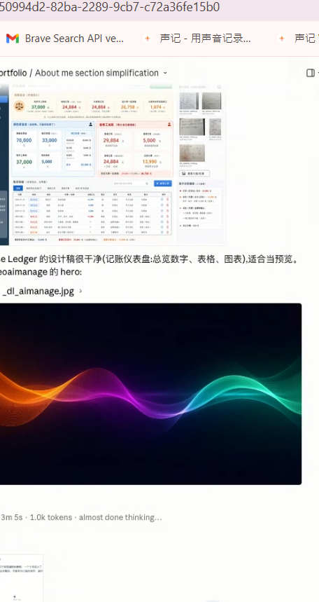

# Mouse Keeper

A lightweight Windows utility that keeps your screen awake by sending tiny, non-clicking mouse movements at a configurable interval.




## Features

- Prevents the display and system from sleeping with the Windows `SetThreadExecutionState` API.
- Sends a 1-pixel right/left mouse micro-movement with `SendInput`; it never clicks.
- Shows live idle time, countdown, simulation count, and current screen/lock timeout status.
- Supports English and Chinese UI text with an in-app language toggle.
- Lets you choose the simulation interval and an optional maximum run time.
- Includes PowerShell helpers for creating a desktop launcher.

## Requirements

- Windows
- Python 3.7 or newer
- No third-party Python packages

## Run

```powershell
python mouse_keeper.py
```

## Create A Desktop Shortcut

```powershell
powershell -ExecutionPolicy Bypass -File create_shortcut.ps1
```

The shortcut uses `launch_mouse_keeper.ps1`, which looks for a valid Python launcher and starts the app without leaving a terminal window open.

## How It Works

Mouse Keeper combines two Windows mechanisms:

1. `SetThreadExecutionState` asks Windows to keep the system and display awake while the app is running.
2. `SendInput` sends tiny relative mouse movement events so Windows sees activity without triggering clicks or disrupting normal work.

The idle timer shown in the app resets after each simulated movement, which makes it easy to confirm that the tool is active.

## Project Structure

```text
mouseclick/
|-- mouse_keeper.py          # Main tkinter application
|-- create_shortcut.ps1      # Creates the desktop shortcut
|-- launch_mouse_keeper.ps1  # Finds Python and launches the app
|-- docs/
|   `-- screenshot.png       # README screenshot
|-- .gitignore
`-- README.md
```

## License

MIT License. Use, modify, and share freely.
